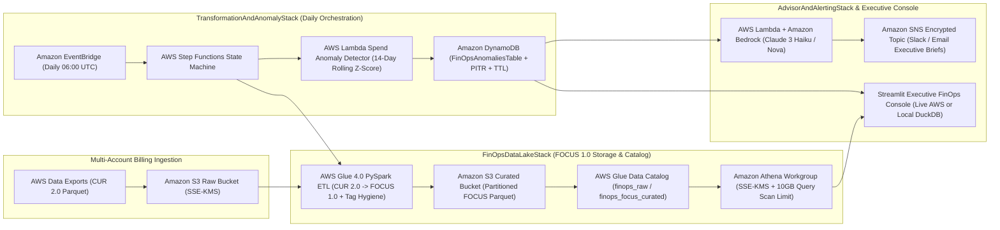

# ☁️ AWS FinOps & Cost Intelligence Platform (FOCUS 1.0 Lakehouse)

[](#cur-20-to-finops-focus-10-schema-mapping)
[-FF9900?style=flat-square)](#technical-architecture)
[](#3-step-local-demo-100-offline--no-aws-account-required)
[](#executive-finops-capabilities)

An enterprise-grade, plug-and-play **Cloud FinOps & Cost Intelligence Lakehouse on AWS** aligned with the **[FinOps Open Cost & Usage Specification (FOCUS 1.0)](https://focus.finops.org/)**.

This platform ingests multi-account **AWS Data Exports (CUR 2.0)**, normalizes billing line items into the vendor-neutral **FOCUS 1.0** schema, enforces tag governance and proportional shared-cost chargeback, runs deterministic **rolling 14-day z-score spend anomaly detection**, and uses **Amazon Bedrock** to synthesize plain-English executive optimization briefs.

---

## Executive FinOps Capabilities

1. **FinOps FOCUS 1.0 Lakehouse Normalization**: Converts raw AWS CUR 2.0 exports into partitioned Parquet/Iceberg tables (`billing_period`, `linked_account_id`) separating `BilledCost`, `EffectiveCost` (amortized Savings Plans / Reserved Instances), and `ListCost`.
2. **Multi-Account Showback & Proportional Chargeback**: Enforces mandatory cost-allocation tags (`CostCenter`, `Environment`, `Owner`, `Project`), flags untagged shadow resources, and proportionally distributes shared transit/networking account costs across consuming business units.
3. **Deterministic Spend Anomaly Detection**: Evaluates a trailing 14-day baseline per `(SubAccountId, ServiceName)` to flag statistically significant daily cost spikes (`z_score >= 2.2`, `pct_spike >= 30%`, `dollar_delta >= $25/day`) such as runaway NAT Gateways, recursive Bedrock agent loops, and unpartitioned Athena scans.
4. **Amazon Bedrock Executive FinOps Advisor**: Translates raw anomaly metrics and idle resource waste (unattached `gp3` EBS volumes, oversized low-CPU `db.r6i.8xlarge` RDS clusters) into actionable executive remediation briefs delivered via **Amazon SNS** (Slack/Email) and an interactive **Streamlit Executive Console**.
5. **Dual-Mode Execution (`DEMO_MODE=true` vs `DEMO_MODE=false`)**: Runs **100% locally offline via DuckDB** out of the box, or switches seamlessly to live **Amazon Athena, DynamoDB, and Amazon Bedrock** once deployed.

---

## Technical Architecture



### Modular AWS CDK Stacks (`infra/`)
| CDK Stack | Provisioned AWS Resources | Security & FinOps Guardrails |
| :--- | :--- | :--- |
| **`FinOpsDataLakeStack`** | Customer-managed KMS Key, Raw CUR 2.0 S3 Bucket, Curated FOCUS S3 Bucket, Athena Results Bucket, Glue Databases (`finops_raw`, `finops_focus_curated`), FOCUS Glue Table, Athena Workgroup | Automatic KMS key rotation, `BlockPublicAccess.BLOCK_ALL`, `enforce_ssl=True`, S3 Intelligent-Tiering & Glacier lifecycle rules, Athena 10 GB per-query scan cutoff |
| **`TransformationAndAnomalyStack`** | AWS Glue 4.0 PySpark Job (`cur-to-focus-normalization-job`), Anomaly Detector Lambda, DynamoDB `FinOpsAnomaliesTable`, Step Functions State Machine, EventBridge Daily Schedule | Least-privilege IAM roles, DynamoDB On-Demand (`PAY_PER_REQUEST`), customer-managed KMS encryption, Point-in-Time Recovery (PITR), 90-day TTL auto-expiry |
| **`AdvisorAndAlertingStack`** | Amazon Bedrock FinOps Advisor Lambda, KMS-encrypted Amazon SNS Topic, EventBridge 06:30 UTC Advisor Trigger | Scoped `bedrock:InvokeModel` permission restricted to approved foundation models, encrypted SNS delivery |

---

## CUR 2.0 to FinOps FOCUS 1.0 Schema Mapping

| AWS CUR 2.0 Column | FinOps FOCUS 1.0 Column | Semantic Purpose |
| :--- | :--- | :--- |
| `bill_payer_account_id` | `BillingAccountId` | Management / Payer account identifier |
| `line_item_usage_account_id` | `SubAccountId` | Linked workload account incurring usage |
| `line_item_usage_account_name` | `SubAccountName` | Human-readable workload account name |
| `bill_billing_period_start_date` | `BillingPeriod` | Partition key (`YYYY-MM`) |
| `line_item_usage_start_date` | `ChargePeriodStart` / `UsageDate` | Granular usage timestamp and daily date |
| `line_item_product_code` | `ServiceName` & `ServiceCategory` | Standardized service and FOCUS category (`Compute`, `Storage`, `Networking`, `AI and Machine Learning`, `Databases`) |
| `line_item_unblended_cost` | `BilledCost` | Cash/invoice cost billed for the charge period |
| `reservation_effective_cost` | `EffectiveCost` | Amortized cost reflecting Savings Plans & Reserved Instances |
| `pricing_public_on_demand_cost` | `ListCost` | Public On-Demand baseline used to calculate Effective Savings Rate (ESR) |
| `line_item_line_item_type` | `ChargeCategory` & `PricingCategory` | Distinguishes `Committed` (SP/RI) vs `On-Demand` vs `Spot` |
| `resource_tags_user_*` | `TagComplianceStatus` & `AllocatedCostCenter` | Evaluates mandatory tags (`CostCenter`, `Environment`, `Owner`, `Project`) and assigns showback/chargeback cost centers |

---

## 3-Step Local Demo (100% Offline — No AWS Account Required)

Run the entire FinOps FOCUS pipeline, 90-day multi-account CUR 2.0 simulator, rolling 14-day anomaly detector, and Executive Streamlit Console locally using **DuckDB**:

```bash
# Step 1: Create virtualenv, install dependencies, and generate 90 days of synthetic CUR 2.0 data
make setup

# Step 2: Run the local CUR 2.0 -> FOCUS 1.0 transformation, anomaly detector & Bedrock simulator
make run-local

# Step 3: Launch the Executive FinOps Console in your browser (DEMO_MODE=true)
make demo
```

### Verification & Test Suite (100% Offline)
```bash
# Runs ruff linter, pytest (CDK assertions + FOCUS compliance + anomaly/advisor tests), and cdk synth
make test
```

---

## 3-Step AWS Deployment Guide

When deploying to a live AWS account, zero code changes are required—all identifiers resolve dynamically via CDK tokens and CloudFormation outputs:

```bash
# Step 1: Configure AWS credentials & region
export AWS_PROFILE=your-finops-profile
export AWS_REGION=us-east-1

# Step 2: Bootstrap CDK, deploy all 3 stacks, and auto-populate .env via scripts/export_env.py
make deploy

# Step 3: Launch the Streamlit Console connected to live Amazon Athena, DynamoDB & Bedrock
DEMO_MODE=false streamlit run app/finops_dashboard.py
```

To tear down all deployed infrastructure cleanly:
```bash
make destroy
```

---

## Solutions Architect Documentation (`docs/`)

- **[AWS Well-Architected Framework Review](docs/WELL_ARCHITECTED_REVIEW.md)**: Detailed evaluation across all 6 Pillars with deep focus on the Cost Optimization Pillar.
- **[Architecture Decision Records (ADRs)](docs/ARCHITECTURE_DECISIONS.md)**: Key architectural trade-offs (FOCUS 1.0 adoption, Lakehouse vs Cost Explorer alone, Deterministic Z-Score + Bedrock vs Black-Box ML, and Multi-Account Tag Governance).
- **[Meta-FinOps Platform Cost Estimate](docs/FINOPS_COST_ESTIMATE.md)**: Line-by-line cost breakdown proving this serverless FinOps platform costs **<$25/month** to operate while typically uncovering **15–30% in cloud waste**.
